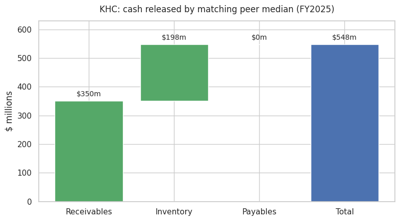
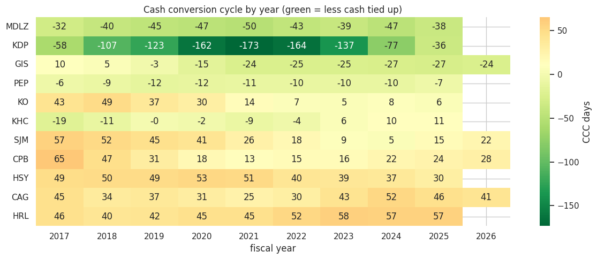
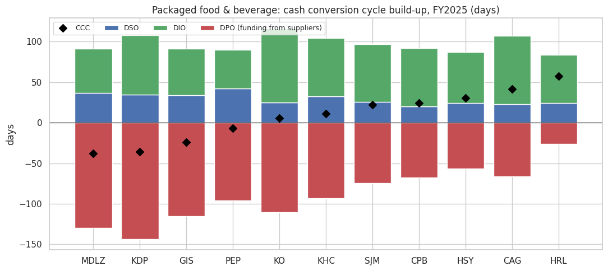
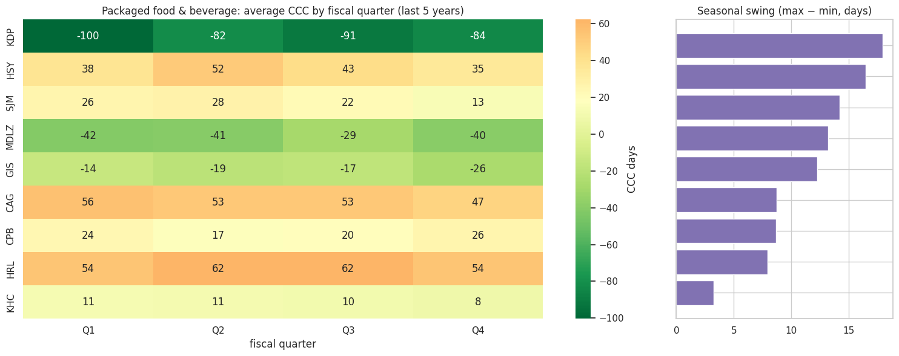
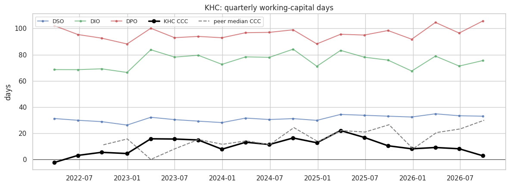
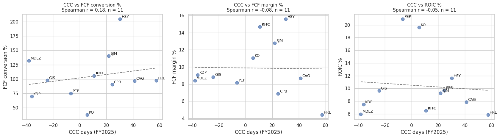
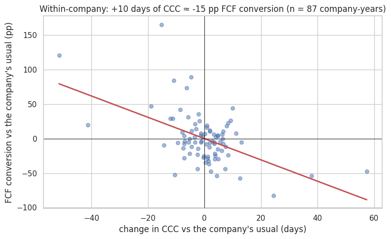
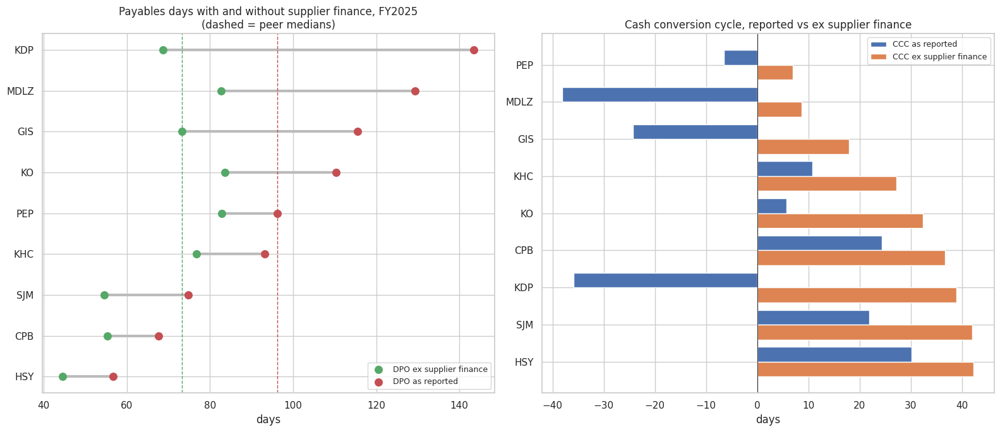

# Working Capital Benchmarking: Any Industry, Straight from SEC Filings

> [!IMPORTANT]
> **Key insights**
> - **$684m cash opportunity at Kraft Heinz:** matching peer-median working capital frees ~$684m, mostly by collecting from customers faster (each day of receivables is worth ~$68m). That's ~19% of a year's free cash flow.
> - **The sector's "negative" cash cycles are largely bank-funded:** strip out supplier finance disclosed under ASU 2022-04 and every company's cycle turns positive. 14 of the peer median's 85 payables days is financing, and Keurig Dr Pepper goes from −36 to +39 days.
> - **Year-end hides the peak:** Hershey ties up ~52 days of cash in Q2 vs ~35 at year-end, so annual balance sheets understate how much funding the business really needs.

**How much cash is stuck in the cash conversion cycle, and how much could a laggard free up by matching its peers?**

A Python / Google Colab tool that pulls 10 years of audited 10-K data straight from SEC EDGAR, benchmarks working-capital efficiency across a peer group in **any industry**, and sizes the cash-release opportunity for an underperformer. The worked case study below is US packaged food & beverage.

[Open the notebook](working_capital_benchmark.ipynb) · Runs end to end in about a minute in Colab, no API key needed.

---

## Why this matters

Working capital is the cheapest source of funding a company has. Every day taken out of the cash conversion cycle (CCC) frees cash for debt paydown, buybacks or capex, with no new financing. It's a standard lens for CFOs, FP&A, treasury, strategy consultants and equity analysts.

| Metric | Formula | What it tells you |
|---|---|---|
| DSO | avg receivables / revenue × 365 | how long customers take to pay |
| DIO | avg inventory / COGS × 365 | how long stock sits before it's sold |
| DPO | avg payables / COGS × 365 | how long the company takes to pay suppliers |
| **CCC** | DSO + DIO − DPO | days of cash tied up in operations |

A negative CCC means suppliers are effectively funding part of the business.

## Use it for any industry

Pick a preset from the dropdown in the config cell, or choose `Custom` and type any US-listed tickers:

| Preset | Peers |
|---|---|
| Packaged food & beverage | PEP, KO, MDLZ, KDP, GIS, HSY, KHC, CAG, CPB, SJM, HRL |
| Household & personal care | PG, CL, KMB, CHD, CLX, EL, COTY |
| Big-box & grocery retail | WMT, TGT, COST, KR, DG, DLTR, BJ, ACI |
| Apparel & footwear | NKE, LULU, TJX, ROST, GAP, PVH, RL, VFC, DECK |
| Home improvement & specialty retail | HD, LOW, BBY, TSCO, WSM, ULTA |
| Pharma & biotech | PFE, MRK, JNJ, ABBV, LLY, BMY, AMGN, GILD |
| Semiconductors | NVDA, AMD, INTC, QCOM, TXN, AVGO, MU, ADI |
| Tech hardware | AAPL, DELL, HPQ, HPE, CSCO, ANET, SMCI |
| Software | MSFT, ORCL, CRM, ADBE, NOW, INTU, WDAY, ADSK |
| Industrial machinery | CAT, DE, CMI, PCAR, ETN, PH, EMR, DOV |
| Autos | GM, F, TSLA |
| Airlines | DAL, UAL, AAL, LUV, ALK, JBLU |

Leave `TARGET` blank and the notebook automatically sizes the opportunity for the peer group's laggard (the company with the longest cash cycle).

## Case study: US packaged food & beverage (FY2025)

- **Wide spread across the peer group:** CCC ranges from about **−38 days (Mondelez)** to about **+57 days (Hormel)**. The peer median is about **11 days** (DSO 26, DIO 71, DPO 93).
- **4 of 11 companies run a negative CCC:** Mondelez, Keurig Dr Pepper, General Mills and PepsiCo. All four stretch payables well beyond 90 days.
- **Kraft Heinz has slipped the most:** its CCC went from about −19 days in 2017 to +11 in 2025, a **30-day** deterioration and the biggest in the group. Campbell's improved the most, taking out about 41 days.
- **Cash opportunity at Kraft Heinz:** matching the peer median would free about **$684m** of cash:
  - Receivables (collect faster): ~$463m
  - Inventory (hold less): ~$221m
  - Payables: $0, because KHC already pays suppliers more slowly than the median, so there's no gap to close

## Seasonality: the quarterly view

Year-end balance sheets show the quietest day of the year. Quarterly 10-Q data shows the peak, which is what treasury actually has to fund.

- **Hershey** ties up the most cash in Q2 (CCC ~52 days vs ~35 in Q4), consistent with building inventory ahead of Halloween.
- **Keurig Dr Pepper** has the biggest seasonal swing (~18 days) but stays deeply negative all year (around −80 to −100 days), thanks to long supplier terms.
- **Kraft Heinz** is the least seasonal (CCC 8–11 days every quarter). Its trade working capital still moves by about **$400m** within a typical year, peaking in Q1.
- Coca-Cola and PepsiCo are left out of the quarterly view: their 10-Qs report payables together with accrued liabilities, which would make the swing look far bigger than it is.

## Does working capital show up in cash flow and returns?

The notebook links the cash cycle to **FCF conversion** (free cash flow ÷ net income) and **ROIC** (NOPAT ÷ average invested capital). Goodwill and intangible impairments are added back, so one-off write-downs (Kraft Heinz, Conagra, Smucker's, General Mills) don't swamp the comparison.

- **Each day of cycle is worth real cash:** for Kraft Heinz, one day of receivables is worth about **$68m** and one day of inventory or payables about **$46m**. That's the practical way to set targets (e.g. "take 5 days out of receivables" ≈ $340m).
- **A mechanical check, not a finding:** within companies, a 10-day longer cycle goes with ~15pp lower FCF conversion. That's expected, not a discovery: the change in working capital is a line in operating cash flow, so a longer cycle lowers free cash flow by construction. The chart below confirms the data behaves as it should.
- **Across peers there's no clear link** (Spearman r between −0.1 and 0.2 for FCF conversion, FCF margin and ROIC). Brand strength, margins and capital structure matter far more than working capital for where a company sits in the league table.
- **For Kraft Heinz,** releasing the ~$684m would lift ROIC only slightly (about 6.9% → 7.0%, because invested capital is ~$60bn, mostly goodwill), but it is a one-off cash inflow worth about **19% of a year's free cash flow**. The case for fixing working capital is cash, not returns.

## Supplier finance: how much of "good" payables is really financing?

Supplier finance (reverse factoring) lets a company stretch payables while a bank pays its suppliers early, so part of a long DPO is really short-term borrowing. Since 2023, **ASU 2022-04** requires US companies to disclose the amount outstanding. The notebook strips it out to get **DPO and CCC ex supplier finance**.

- **The benchmark is inflated:** peer-median DPO is ~85 days as reported but ~71 days ex supplier finance, so 14 days of "best practice" payables is bank financing.
- **Negative cycles disappear:** Mondelez ($3.6bn of supplier finance, 35% of payables), Keurig Dr Pepper ($1.4bn, 46%) and General Mills ($1.4bn, 38%) all run negative cash cycles as reported, and positive ones once the financing is removed. Keurig Dr Pepper drops five places in the ranking.
- **Kraft Heinz:** has its own $755m programme (17.5% of payables, ~4% of net debt). On a like-for-like basis it still has no payables gap to peers, so the opportunity remains receivables and inventory, not "pay suppliers later".
- **The data itself is patchy:** Kraft Heinz discloses its programme only in 10-K text, not in the machine-readable XBRL data, and Conagra tags it only in quarterly filings. Untagged companies are treated as *unknown*, not zero, and hand-collected amounts are added with their source.

**So what for a CFO:** before telling a company to "stretch payables to the peer median", check how much of that median is bank-funded, because copying it means adding debt-like financing, not improving operations.

## How it works

1. **Data:** SEC EDGAR XBRL `companyfacts` API (free, primary-source 10-K data). Tickers are mapped to CIKs automatically.
2. **Cleaning:** companies tag the same line item differently (e.g. `AccountsReceivableNetCurrent` vs `AccountsAndOtherReceivablesNetCurrent`), so each item uses a ranked list of XBRL tags. Annual flows are kept only for ~12-month periods, and restated values from later filings take priority.
3. **Industry edge cases:**
   - Companies with no inventory (software) get DIO = 0 instead of being dropped.
   - LIFO reporters (e.g. Kroger) get inventory derived as FIFO cost minus LIFO reserve.
   - Cash-and-card retailers that rarely report receivables have those treated as 0.
   - Companies with no cost-of-sales line (airlines) use total operating costs as a flagged proxy.
4. **Fiscal-year alignment:** each fiscal year is labelled by the calendar year most of it falls in, so Walmart (January year-end) and General Mills (May) line up with December filers.
5. **Data quality:** payables reported together with accrued liabilities (which overstates DPO) are excluded, and a tag log shows which tag fed every number.
6. **Metrics:** DSO / DIO / DPO / CCC on average balances, which smooths out year-end window dressing.
7. **Benchmarking:** peer median and top quartile, a heatmap over time, and target vs peer interquartile range.
8. **Opportunity sizing and sensitivity:** day gaps converted to dollars, lever by lever, plus cash freed per day of improvement.
9. **Seasonality:** Q1–Q3 from 10-Qs, Q4 balances from the 10-K and Q4 flows as full year minus Q1–Q3, labelled by fiscal quarter.
10. **Cash flow and returns:** FCF = operating cash flow − capex; ROIC = operating income before impairments × (1 − effective tax rate) ÷ average (equity + debt − cash).
11. **Supplier finance:** confirmed supplier-finance balances (ASU 2022-04 XBRL tag, company-specific tags as fallback, hand-collected amounts from 10-K text where untagged) are removed from payables to get DPO and CCC ex-SCF.
12. **Export:** everything goes to `working_capital_benchmark.xlsx`.

## Limitations

- **Tags aren't always comparable:** some receivables lines include non-trade items.
- **Supplier finance coverage starts in FY2023** and assumes the balance sits inside accounts payable; programmes below a company's materiality threshold, and untagged ones not collected by hand, are missed.
- **Receivables factoring or securitisation** lowers DSO without any change in customer behaviour.
- **Industries differ structurally:** only compare within a peer group. For software, DPO is measured against a small cost base and is noisy, so focus on DSO there.
- **M&A distorts averages:** deals like KDP's merger and KHC's divestitures cause step changes.
- **Quarterly data is rougher:** Q4 flows are derived and quarter-end (not average) balances are used.
- **ROIC is simplified:** invested capital isn't adjusted for leases, goodwill or pensions, and correlations across ~10 companies are suggestive, not proof.
- **Benchmarking isn't target-setting:** channel mix and geography can justify a different cycle.
- **US filers only:** companies that don't file 10-Ks with the SEC (e.g. most Indian or European listings) aren't covered.

## Run it yourself

1. Open the notebook in [Google Colab](https://colab.research.google.com/) (File → Upload notebook, or open it from GitHub).
2. Set `USER_AGENT` to your name and email. SEC requires this for API access.
3. Pick an industry (or Custom tickers), then Runtime → Run all.

## Tools

Python · pandas · NumPy · matplotlib · seaborn · requests · SEC EDGAR XBRL API · Google Colab
